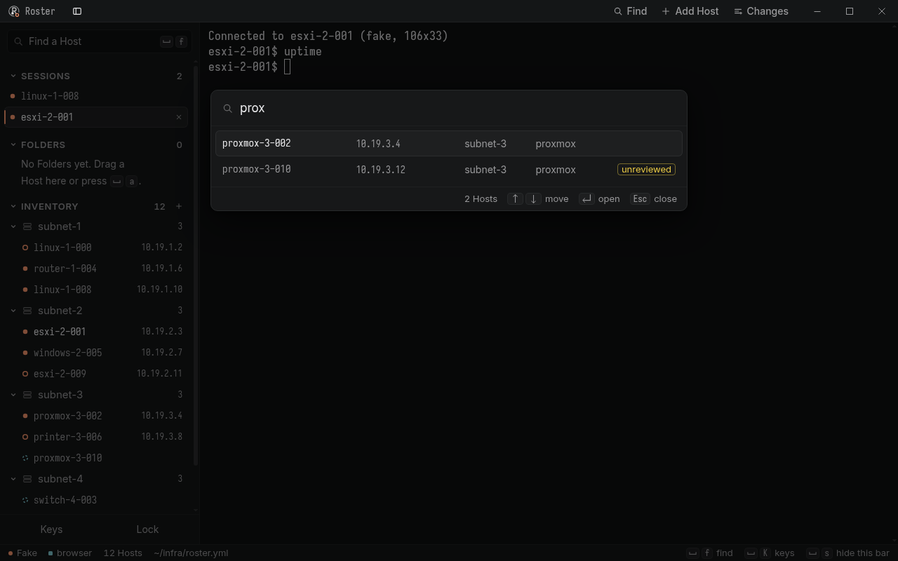
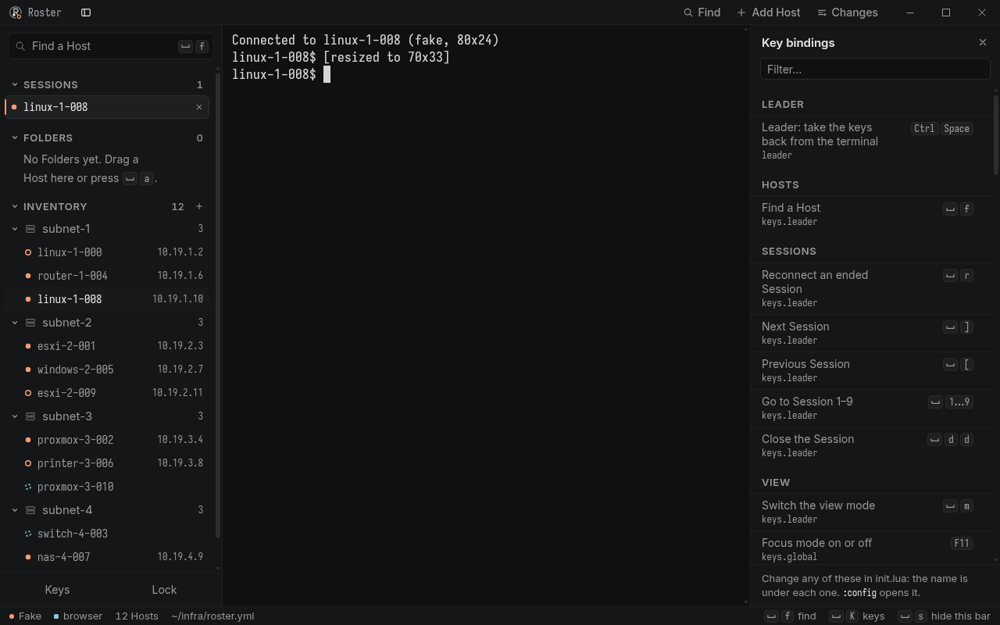
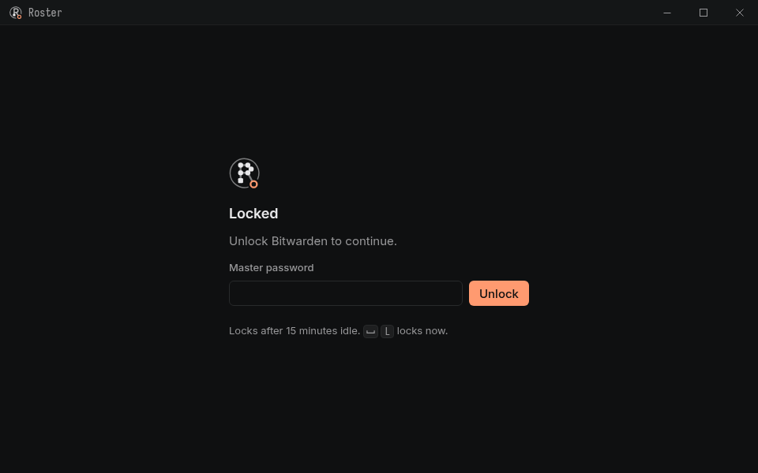

<p align="center">
  <picture>
    <source media="(prefers-color-scheme: dark)" srcset="app/assets/logo-mark.svg">
    <source media="(prefers-color-scheme: light)" srcset="app/assets/logo-mark-light.svg">
    
  </picture>
</p>

<h1 align="center">roster</h1>

<p align="center">
  Your password manager knows the secrets. roster knows your network.<br>
  A team's hosts in one file, logins from the shared vault, and a keyboard-first app to reach them.
</p>

<p align="center">
  <a href="https://github.com/2styx2/roster/actions/workflows/ci.yml?query=branch%3Adev"></a>
  <a href="https://github.com/2styx2/roster/releases"></a>
  
  <a href="LICENSE"></a>
</p>

<p align="center">
  <picture>
    <source media="(prefers-color-scheme: dark)" srcset="docs/images/app-dark.webp">
    <source media="(prefers-color-scheme: light)" srcset="docs/images/app-light.webp">
    
  </picture>
</p>

## What it is

A password manager holds an item like `ESXI web`, but it doesn't know that the item opens both SSH and the API on one host, that two boxes with the same web title are different machines, or that the core switch only takes a password over SSH. That knowledge usually lives in someone's head, a stale wiki page, or a dozen `~/.ssh/config` files that all differ.

roster keeps it in one file, `roster.yml`, in your team's own private git repo:

- **Hosts and what they are:** name, address, type, product, title, description.
- **How to reach them:** SSH port and user, key or password only, web UIs and other services.
- **Which login goes where:** references to vault items (`bw:esxi-02 ssh+web`, `op:Network gear`), never a password.

It comes in two parts that share that file:

- **The CLI, `roster`** (Python). It sets up each box with its own SSH key, runs commands on password-only gear, calls web APIs with the stored login, scans networks into the inventory, and tells Claude which hosts exist without ever showing it a secret.
- **The roster app** (Tauri, for Windows and Linux). A fast, keyboard-first terminal: find a Host in a few keystrokes and you're in a shell, with the password fetched from the vault and never shown. It talks to the CLI through `roster serve`, so the file and the vault stay roster's.

> **Status:** pre-release. Everything builds up on `dev`; the first Release, `v0.1.0`, comes after iteration 4 ([roadmap](docs/app/roadmap.md)).

## Features

**The CLI**

- `roster setup`: one key per box, host fingerprints recorded, the key installed where hosts take one, and `ssh <host>` just works.
- `roster run HOST -- CMD`: password-only gear (switches, appliances) with the password fetched for that one run, and `--sudo`.
- `roster web HOST api …`: web API calls made with the service's stored login.
- `roster discover 10.0.1.0/24 --write`: an nmap sweep becomes inventory, marked unreviewed until a person looks.
- `roster check`: SSH, web UI and service ports on every host; `roster check HOST` says which step fails and what to do.
- Password providers: Bitwarden, 1Password, `pass`, KeePassXC, an environment variable, or any command.
- `ROSTER.md` for Claude: which hosts exist and how to reach them, with rules. Claude uses `ssh`, `roster run` and `roster web`; roster supplies the credentials and Claude sees only the output.

**The app**

- **The Picker:** fuzzy-find any Host by name, address or group, then Enter. Or type `user@address` for a Quick Connect.
- **Sessions** over your own `ssh`, by key or password. A password goes from the vault to ssh through a one-time askpass channel and never reaches the UI.
- **The lock screen is the vault:** unlock Bitwarden to start (or sign in, two-step methods included), and it locks itself after 15 minutes idle.
- **Edit the inventory in place:** add or edit a Host with a test login first, see the diff, and Publish it to the team's git repo.
- **Keyboard first:** the Leader (Ctrl+Space) takes the keys back from the terminal; vim keys; keycaps next to everything.
- **Configured in code:** one `init.lua`, like Neovim or WezTerm, applied with `:source`, six bundled Themes, and `:help` for every option.
- **Plain errors:** each connection failure says where it lives (the vault, the network, the Host) and the one thing to do next.

<table>
  <tr>
    <td width="50%">
      <picture>
        <source media="(prefers-color-scheme: dark)" srcset="docs/images/keys-dark.webp">
        <source media="(prefers-color-scheme: light)" srcset="docs/images/keys-light.webp">
        
      </picture>
    </td>
    <td width="50%">
      <picture>
        <source media="(prefers-color-scheme: dark)" srcset="docs/images/lock-dark.webp">
        <source media="(prefers-color-scheme: light)" srcset="docs/images/lock-light.webp">
        
      </picture>
    </td>
  </tr>
  <tr>
    <td>Every binding shows its keys and the option that changes it (<code>␣ K</code>).</td>
    <td>Unlocking the vault is the app's lock.</td>
  </tr>
</table>

<sub>The screenshots use the app's built-in fixtures: made-up Hosts on made-up addresses, with a fake terminal.</sub>

## Install

### The app

Download it from [Releases](https://github.com/2styx2/roster/releases):

| Platform | File |
|---|---|
| Windows | `roster-app-<version>-windows-x64-setup.exe` (or the `.msi`, or the portable `.zip`) |
| Linux | `roster-app-<version>-linux-x64.AppImage` or `.deb` (or the `.tar.gz` with the bare binary) |
| macOS | `roster-app-<version>-macos-universal.dmg` (it builds; it isn't tested day to day yet) |

The app needs the roster CLI on the same machine; on Windows it also finds a roster installed in WSL. The builds aren't code-signed yet, so Windows SmartScreen asks once ("More info", then "Run anyway") and macOS needs right-click, Open the first time. Each Release has a `SHA256SUMS` to check the files against.

### The CLI

Requires Python 3.10+, the OpenSSH client, [uv](https://docs.astral.sh/uv/), and your password manager's CLI (`bw` or `op`). nmap is optional, for `discover`.

```bash
uv tool install git+https://github.com/2styx2/roster      # from the repo
uv tool install ./roster-<version>-py3-none-any.whl       # or the wheel from a Release
roster man --install                                      # the man page, next to the roster command
roster --help
```

Or use the installer. It walks through every stage (uv, roster, the Bitwarden CLI, your team's config repo, `ROSTER_CONFIG`, unlocking the vault, `roster setup`, auto-updates), asks before each change, and is safe to re-run:

```bash
git clone https://github.com/2styx2/roster.git && cd roster
./install.sh              # interactive
./install.sh --dry-run    # show what it would do, change nothing
```

A Release also has `roster-cli-<version>.tar.gz`: unpack it and run `./install.sh` inside, no git needed. `install.sh --prefix DIR` puts the command in `DIR/bin` instead of `~/.local/bin`.

After installing, either way, `man roster` shows the manual: the man page goes to `PREFIX/share/man/man1/roster.1`, next to `PREFIX/bin/roster`, where `man` looks. Setting up another box, step by step: [docs/new-box.md](docs/new-box.md).

## Quick start

```bash
mkdir ~/infra && cd ~/infra
roster discover 10.0.1.0/24 --write   # start from a scan (or `roster init` for the commented example)
# edit roster.yml: names, users, vault items; set reviewed: true on the groups you checked
roster auth-check                     # can every login be found? (prints nothing secret)
roster setup --dry-run && roster setup
roster hosts --find orion
ssh orion-dev-01 uptime               # key login just works
roster run net-sw-core-01 -- show ver # password-only gear; the password is fetched for you
```

Point `ROSTER_CONFIG` at the file (`export ROSTER_CONFIG="$HOME/infra/roster.yml"`) so every command and the app find it. Then open the app, unlock the vault, press **Ctrl+Space f**, type part of a Host's name and press **Enter**.

**Your `roster.yml` is private.** It names your hosts, addresses, users and vault items, so it belongs in your team's own private repo, never in a public one and never in this one.

## Configuration

- **The CLI** reads `roster.yml`. The format, the providers and every command are in the [CLI reference](docs/cli-reference.md); [examples/roster.example.yml](examples/roster.example.yml) is a fully commented example (also what `roster init` writes).
- **The app** reads `init.lua` (`%APPDATA%\roster\init.lua` on Windows, `~/.config/roster/init.lua` on Linux). `:config` opens it, `:source` applies it, and `:help` explains every option and where its value came from. [examples/init.lua](examples/init.lua) has every option with its default; [docs/app/config.md](docs/app/config.md) is the reference.

## Documentation

Start at **[docs/README.md](docs/README.md)**, the index of every doc. In the app, the same docs are inside it: `:help start` is where to begin, and `␣ ?` finds any topic.

**Docs: [on the web](https://2styx2.github.io/roster/) · [PDF](https://2styx2.github.io/roster/roster-docs.pdf).** The same pages as `:help`, made from the same source; each Release carries the PDF too.

| Doc | For |
|---|---|
| [docs/README.md](docs/README.md) | Every doc, grouped: getting started, making it yours, reference, extending, working on roster |
| [docs/app/start.md](docs/app/start.md) | New to the app: open a Host, find any command, make it yours |
| [docs/app/recipes.md](docs/app/recipes.md), [docs/app/extending.md](docs/app/extending.md) | `init.lua` snippets to paste, and how far roster bends (the registries) |
| [docs/cli-reference.md](docs/cli-reference.md) | `roster.yml`, resources, password providers, `discover`, every command, how Claude uses it |
| [docs/new-box.md](docs/new-box.md) | Setting up roster on another box (a teammate's machine, a jump host, a Claude box) |
| [docs/adding-hosts.md](docs/adding-hosts.md) | Adding a network or host, wiring it to vault items, testing the logins |
| [docs/serve-api.md](docs/serve-api.md) | `roster serve`: the JSON-RPC API the app uses, and its error codes |
| [app/README.md](app/README.md) | The app: module map, the two builds, fixtures, the Windows build loop |
| [docs/app/](docs/app/) | The app's design: [keyboard](docs/app/keyboard.md), [Config](docs/app/config.md), [Themes](docs/app/themes.md), [errors](docs/app/errors.md), [architecture](docs/app/architecture.md), [decisions](docs/app/decisions.md) |
| [docs/adr/](docs/adr/) | Architecture decisions for the CLI and the app |
| [docs/development.md](docs/development.md) | Working on the CLI: checks, the module map, trying it safely |
| [docs/releasing.md](docs/releasing.md) | Cutting a Release |
| [GLOSSARY.md](GLOSSARY.md) | The words, for the CLI and the app |

## Security

- **No passwords on disk.** They're fetched from the vault when needed, kept in memory for one run, and never written or printed.
- **Each box has its own SSH key**, tagged with the box's name, so `roster revoke` removes exactly one box's access.
- **Secrets never reach the app's UI or its Rust core.** ssh gets a password from `roster serve` through a one-time askpass token.
- **Scanned hosts are left alone** until a person marks them reviewed.

The details: [the CLI's security model](docs/cli-reference.md#security-model) and [the app's](docs/app/security.md).

## Contributing

Work happens on branches cut from `dev` and lands through pull requests that the maintainer reviews and merges; [CONTRIBUTING.md](CONTRIBUTING.md) has the branch model and the commit rules. Tickets are [GitHub issues](https://github.com/2styx2/roster/issues), one milestone per iteration. The checks CI runs:

```bash
uv run ruff check src tests && uv run pytest     # the CLI
cd app && npm ci && npm run check               # the app's frontend
cargo test && cargo clippy -p roster-core --all-targets -- -D warnings && cargo fmt --check
```

## License

GPL-3.0-or-later. See [LICENSE](LICENSE).
