# Themes

A Theme (GLOSSARY) is a named set of colour tokens: 22 UI tokens, the terminal's own colours and,
optionally, its 16 ANSI colours. `app/src/theme/theme.ts` says what each token colours,
`app/src/theme/themes.ts` holds the bundled ones, and [config.md](config.md) shows how `init.lua`
picks, changes or defines one.

## Choosing one: `:theme`

- `:theme` (or `:finder themes`) opens a finder over every registered Theme: the bundled ones,
  `init.lua`'s and, later, a Plugin's. The Theme under the cursor is previewed live, terminal
  included. **Enter** applies it and keeps it, **Esc** puts the old one back.
- `:theme ID` (`:theme nord`) switches straight away. It completes Theme ids.
- Like Neovim's `:colorscheme`, a choice always applies. It's kept in the State (key `theme`),
  not the Config. A stored Theme that's no longer registered is ignored.
- **A choice made over `init.lua`'s `theme` stays until that value changes** (Q69). If `init.lua`
  names a Theme (`theme = "nord"`), the State also keeps that value (key `themeOver`) with the
  choice. The choice wins at start-up and on `:source` while `init.lua` still names that same
  Theme; edit `init.lua`'s `theme` to something else and the file wins again. The finder's note
  (`init.lua:12 sets "nord"; Enter overrides it until that line changes`) and a one-time message
  say which line sets it; delete that line to unpin it. `theme = "auto"` (the default) leaves the choice to the picker; without a
  choice it follows the OS with `dark_theme` / `light_theme`.
- `:config import-terminal` defines a Theme for Windows Terminal's colour scheme in `init.lua`
  but doesn't set `theme`: it chooses the Theme as `:theme` does, so `:theme` can change it.

Order of precedence: a preview, then the State's choice while it wins (as above), then
`init.lua`'s `theme`, then `auto`.

## Bundled Themes

| id | Label | Source | License |
|---|---|---|---|
| `roster-dark` | Roster dark | Our own: Apricot flare on Ink (Q57) | — |
| `roster-light` | Roster light | Our own: Apricot flare on Paper (Q57) | — |
| `gruvbox` | Gruvbox Dark | [morhetz/gruvbox](https://github.com/morhetz/gruvbox), `colors/gruvbox.vim` | MIT/X11 (README, `package.json`) |
| `nord` | Nord | [nordtheme.com](https://www.nordtheme.com/docs/colors-and-palettes), [nordtheme/nord](https://github.com/nordtheme/nord) `app/src/nord.css`, terminal colours from [nordtheme/alacritty](https://github.com/nordtheme/alacritty) | MIT (© Sven Greb) |
| `catppuccin-mocha` | Catppuccin Mocha | [catppuccin/palette](https://github.com/catppuccin/palette), `palette.json` (`mocha.colors`, `mocha.ansiColors`) | MIT (© Catppuccin) |
| `tokyo-night` | Tokyo Night | [folke/tokyonight.nvim](https://github.com/folke/tokyonight.nvim), the **night** style: `lua/tokyonight/colors/night.lua` over `storm.lua`; terminal and ANSI colours from `extras/kitty/tokyonight_night.conf` | Apache-2.0 (the repo's `LICENSE`; the generated extras say MIT) |

All four are permissive, and only colour values are used, no code. Roster dark and light keep the
neutral standard ANSI palette (Q37); the others bring their own from the same source.

### How each palette maps to the tokens

**Gruvbox Dark**, medium contrast (`bg0` = `dark0`): bg `#282828`, chrome and Sidebar
`dark0_hard` `#1d2021`, panel and hover `dark0_soft`, raised `dark1`, lines `dark1`/`dark2`, text
`light1`, muted `light4` (lifted, see below), faint `dark4`. Accent `bright_yellow` `#fabd2f` with
`dark0` text, tone `bright_aqua` `#8ec07c`; warn `bright_orange`, error `bright_red` (lifted), danger `neutral_red`. Terminal: `bg0`/`fg1`, ANSI as
`gruvbox.vim` sets `g:terminal_color_0..15`. For the orange accent, in `init.lua`:
`colors = { accent = "#fe8019", accent_ink = "#fe8019" }` (`#282828` on it is 5.84:1).

**Nord**: bg, chrome and Sidebar `nord0` (as Nord's own editor ports do, with hairlines between),
panel and hover `nord1`, raised `nord2`, raised line `nord3`, text `nord6`, accent frost `nord8`
`#88c0d0` with `nord0` text, tone Aurora purple `nord15` `#b48ead` (3.05:1 on `nord2`, the tightest tone; Aurora green is too close to the frost accent); warn `nord13`, error (lifted) and danger `nord11`. Terminal and ANSI from the
official Alacritty port; search matches `nord2`, the active one `nord10`.

**Catppuccin Mocha**: bg `base`, chrome, Sidebar and panel `mantle`, hover and lines `surface0`,
raised `surface1` (line `surface2`), text `text`, muted `subtext0` (lifted), faint `overlay1`. Accent
`mauve` with `crust` text, tone `teal` `#94e2d5`; warn `yellow`, error (lifted) and danger `red`. Cursor `rosewater`, selection
`surface2` (the Windows Terminal port's). ANSI from `ansiColors`.

**Tokyo Night** (night, not storm: closest to Roster dark's near-black): bg `#1a1b26`, chrome,
Sidebar and panel `bg_dark` `#16161e`, raised and lines `bg_highlight`, raised line and strong
lines `fg_gutter`, text `fg`, muted `fg_dark`, faint `dark5`. Accent `blue` `#7aa2f7` with
`bg_dark` text (for purple: `accent = "#bb9af7"`), tone `teal` `#1abc9c`; warn `yellow`, error `red`, danger `red1`.
Search matches `blue0`, the active one `orange`, as the Neovim theme does.

### Where a token isn't a palette colour

| Theme | Token | Value | Why |
|---|---|---|---|
| Nord | `faint` | `#7b88a1` | Nord has no colour between `nord3` and `nord4`; this sits between them (icons and rules only, never text) |
| Nord | `muted` | `#b7bcc5` | The Alacritty port's `dim_foreground` `#a5abb6`, lifted to 4.5:1 on `nord2` (ticket 29, M2) |
| Nord | `error` | `#dfb0b5` | `nord11` `#bf616a` mixed toward white until it reads at 4.5:1 on `nord2` (it was 2.1:1) |
| Nord | `accent_ink` | `#8fc4d3` | `nord8`, a touch lighter for 4.5:1 on `nord2` |
| Gruvbox Dark | `muted`, `error` | `#aea08c`, `#fc7b6c` | `light4` and `bright_red`, lifted to 4.5:1 on `dark1` |
| Catppuccin Mocha | `muted`, `error`, `accent_ink` | `#afb6ce`, `#f59db5`, `#cca7f7` | `subtext0`, `red`, `mauve`, lifted to 4.5:1 on `surface1` |
| Tokyo Night | `hover` | `#1f2335` | storm's `bg_dark`: night has no step between `bg` and `bg_highlight` |
| all four | `backdrop`, `shadow` | translucent black (Catppuccin: `crust`) | overlays, not colours |

### Roster dark and light

**Apricot flare** on **Ink** and **Paper**, with **Sea glass** as the second tone:

| Token | Roster dark | Roster light |
|---|---|---|
| `accent` | `#ff9a70` (Apricot flare) | `#9b411a` (the deeper apricot, so white reads on it) |
| `accent_text` | Ink `#0f1011` (9.17:1) | `#ffffff` (6.64:1) |
| `accent_ink` | `#ffa076` | `#9b411a` |
| `tone` | `#82ccd5` (Sea glass) | `#296d82` |
| `bg` | Ink `#0f1011` | `#f2f2f4` |
| `chrome`, `sidebar` | `#141617` | Paper `#e8e8ea` |
| `text` | Paper `#e8e8ea` | `#1e1f20` |
| `warn` | `#e9c944` (yellow) | `#5d580c` |
| `error` | `#e25a98` (raspberry) | `#a11d6c` |
| `danger` | `#b9205c`, white glyph | `#b9205c`, white glyph |

**The second tone** (`tone`) marks *place*, never action: this Box's square in the status bar and the
dashed ring of an unreviewed Host. It's a shape colour only (`app/src/styles.test.ts` fails if a
rule colours text with `--tone`), held at 3:1 on every surface. Every bundled Theme has one from its
own palette (above); a Theme of your own that leaves it out gets its base's.

**Warn and error moved off the accent.** Next to the apricot, the old amber warn and red error
read as the accent (ΔE 7.7–13), so warn is yellow and error raspberry; the contrast test keeps
both, and danger, at least 12 apart from the accent in Roster dark and light. The terminal keeps the
standard ANSI palette (Q37); its selection is a dim apricot.

**The app icon (decision Q59)** has no tile. It's the Gap orbit on a transparent background, and
because it can't know whether it sits on the dark Windows taskbar (`#202020`) or the light one
(`#f3f3f3`), it uses neither Theme's colours but a middle pair that holds 3:1 on both, and on
Ink, Paper, white and black:

| Part | Colour | Dark taskbar `#202020` | Light taskbar `#f3f3f3` | Ink / Paper |
|---|---|---|---|---|
| R, orbit, Box | `#808183` (mid-tone neutral) | 4.18:1 | 3.51:1 | 4.88 / 3.19 |
| Host ring | `#cc5c2b` (mid apricot) | 3.98:1 | 3.69:1 | 4.66 / 3.34 |

Paper would vanish on the light taskbar (1.10:1) and Ink on the dark one (1.17:1); Apricot flare
`#ff9a70` is 1.87:1 on the light taskbar and `#9b411a` 2.46:1 on the dark one, so neither Theme
accent serves both. The marks inside the app (title bar, lock screen, empty states) keep drawing
from the Theme's `text` and `accent` (`app/src/chrome/Logo.tsx`).

## The contrast test

`app/src/theme/contrast.test.ts` measures WCAG 2 ratios for every bundled Theme (tickets 30 and 29):

- every **text token** (`text`, `muted`, `warn`, `error`, `accent_ink`) at least **4.5:1** on every
  surface text sits on: `bg`, `chrome`, `sidebar`, `panel`, `raised` and `hover`;
- the accent (the live Session's 2px bar, decision Q53) at least **3:1** against `sidebar` and `raised`;
- the second tone (`tone`, shapes only) at least **3:1** against every surface, and at least 12
  (OKLab ΔE ×100) from the accent, so an unreviewed node never looks live;
- the accent's button text (`accent_text` on `accent`) at least **4.5:1**;
- the close button's glyph (`danger_text` on `danger`) at least **3:1** (4.5:1 in Roster dark and
  light, where `warn`, `error` and `danger` must also be at least 12 from the accent);
- terminal foreground at least **4.5:1** on the terminal background.

The values above that were lifted are the nearest ones (mixed toward white, so the hue stays)
that pass. Lowest ratio of `muted` (the weakest text token in most Themes):

| Theme | muted, lowest | accent text | tone, lowest |
|---|---|---|---|
| Roster dark | 5.73 (raised) | 9.17 | 9.08 (raised) |
| Roster light | 5.56 (chrome) | 6.64 | 4.76 (chrome) |
| Gruvbox Dark | 4.53 (raised) | 8.69 | 5.51 (raised) |
| Nord | 4.52 (raised) | 6.24 | 3.05 (raised) |
| Catppuccin Mocha | 4.52 (raised) | 9.23 | 6.12 (raised) |
| Tokyo Night | 6.36 (raised) | 7.14 | 5.57 (raised) |

**`faint` is not a text colour** (decision Q53): it's for icons, chevrons, dots' outlines and rules
only, and isn't held to a text ratio. All real text (labels, hints, addresses, counts, headings,
the status bar) uses `muted`, and hierarchy comes from size and weight. `app/src/styles.test.ts` fails
if a stylesheet rule colours text with `--faint`. A Theme of your own should keep `muted` at 4.5:1.

## Screenshots

Standard with a Session open, and the picker, in each Theme, in
[design/themes/](design/themes/): `<id>-standard.png` and `<id>-picker.png`. They are made with
Playwright (Chromium, 1180×740) against the Vite dev server and the fake Backend, so they show only
fixture data: in `app/`, `npm run dev -- --port 5179`, open
`http://localhost:5179/?fixture=few-hosts&theme=<id>&toggle=off`, unlock with `correct horse`, open
`linux-1-000` from the Picker, then open the Picker again and type `esxi`.

| Theme | Standard | Picker |
|---|---|---|
| Roster dark | 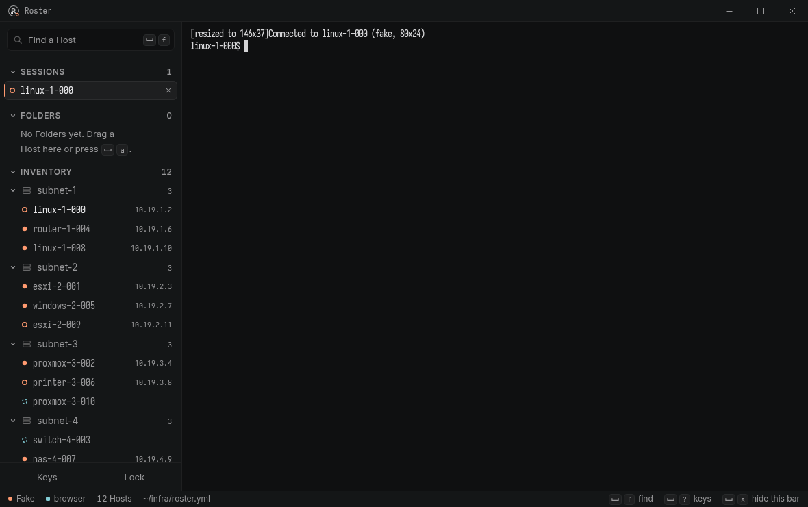 | 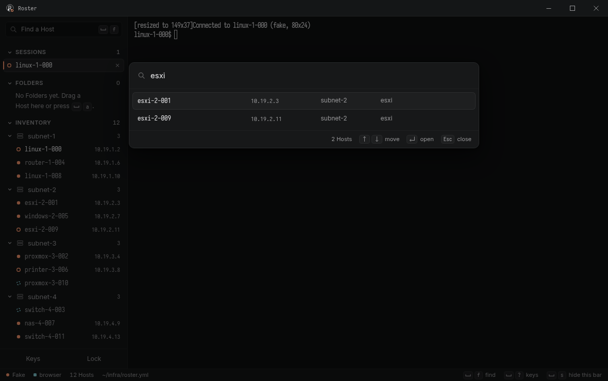 |
| Roster light | 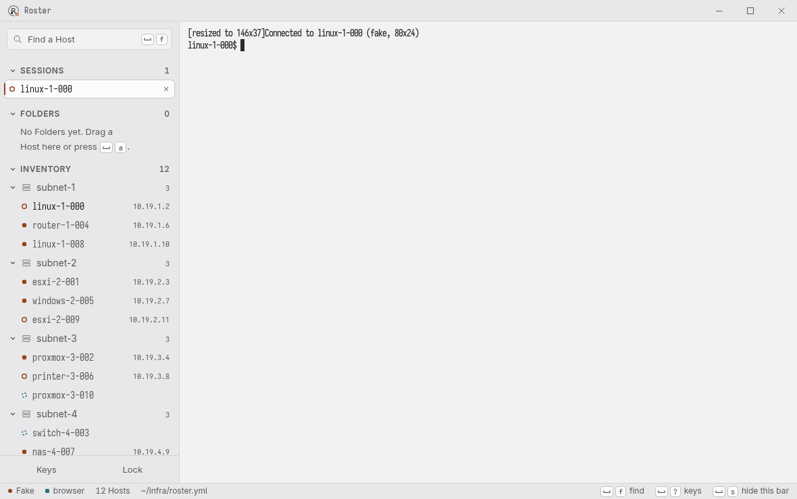 | 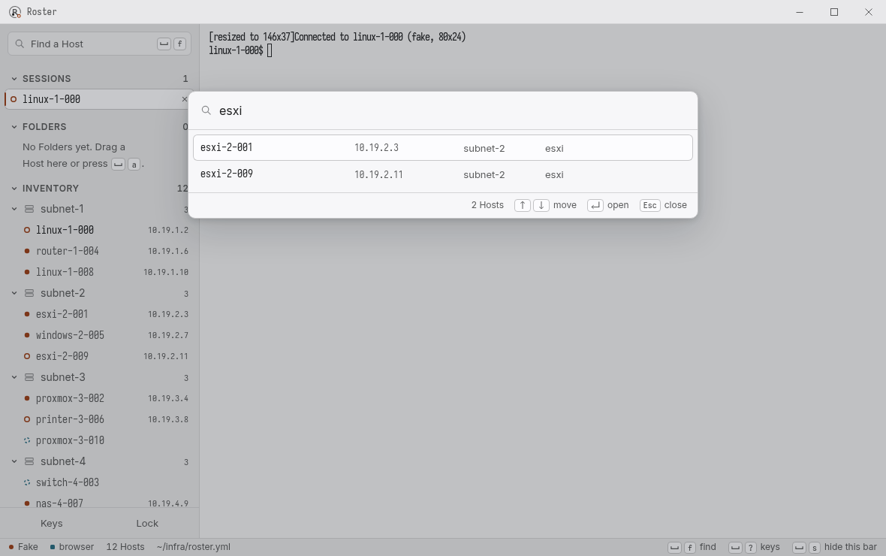 |
| Gruvbox Dark | 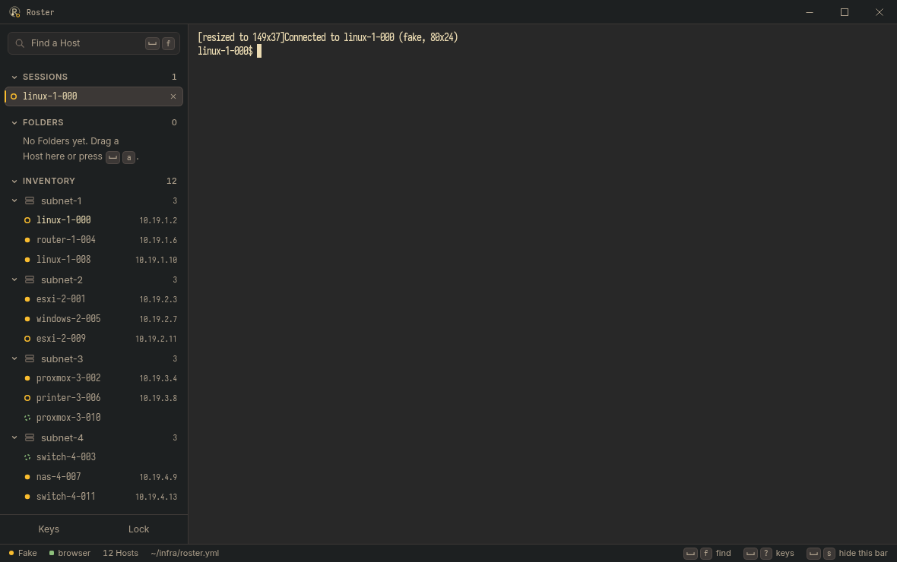 | 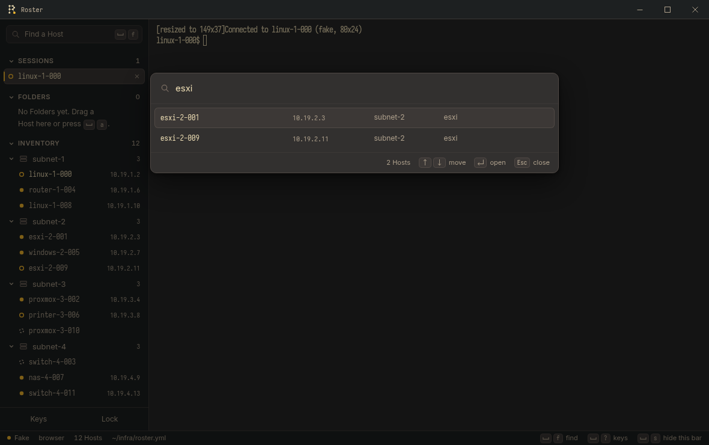 |
| Nord | 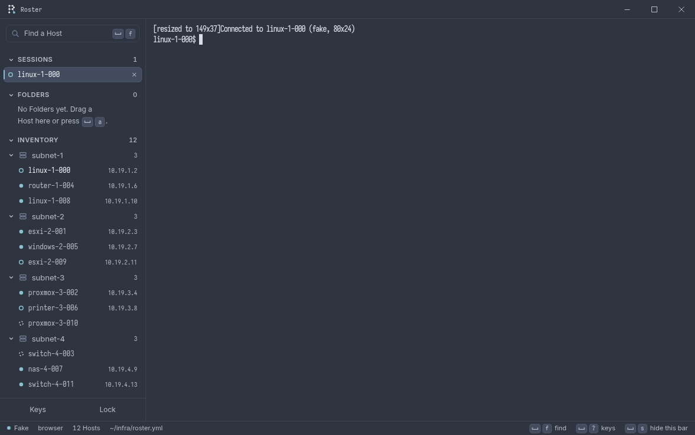 | 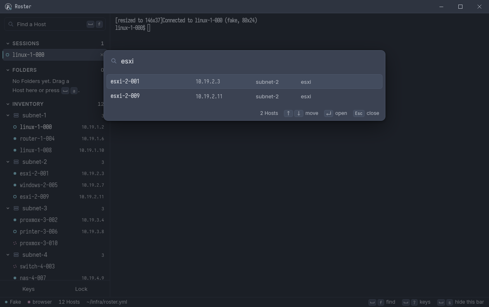 |
| Catppuccin Mocha | 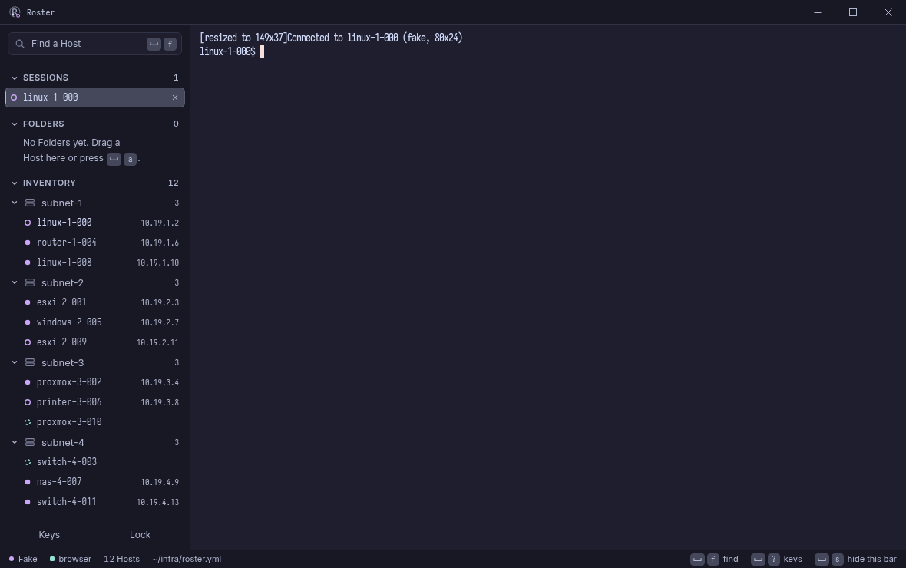 | 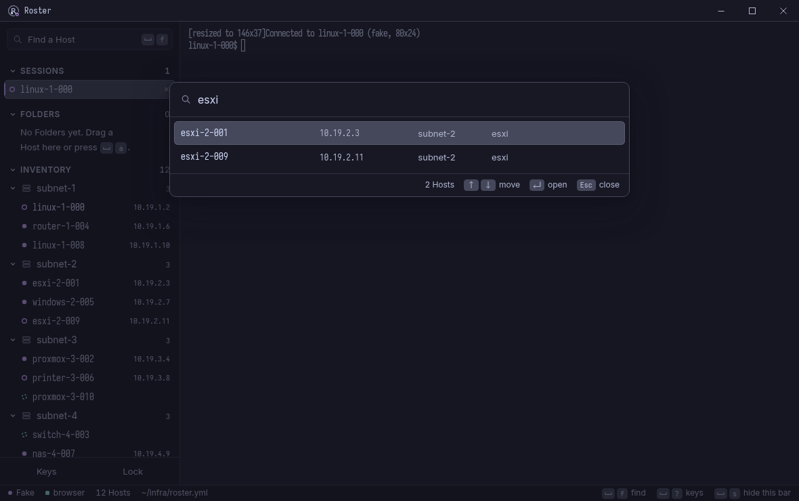 |
| Tokyo Night | 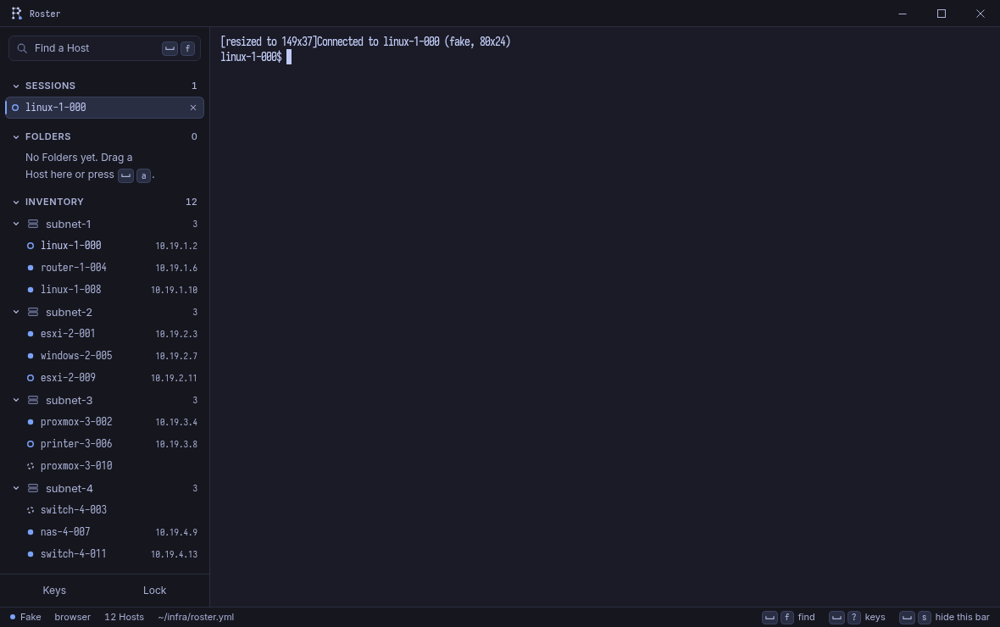 | 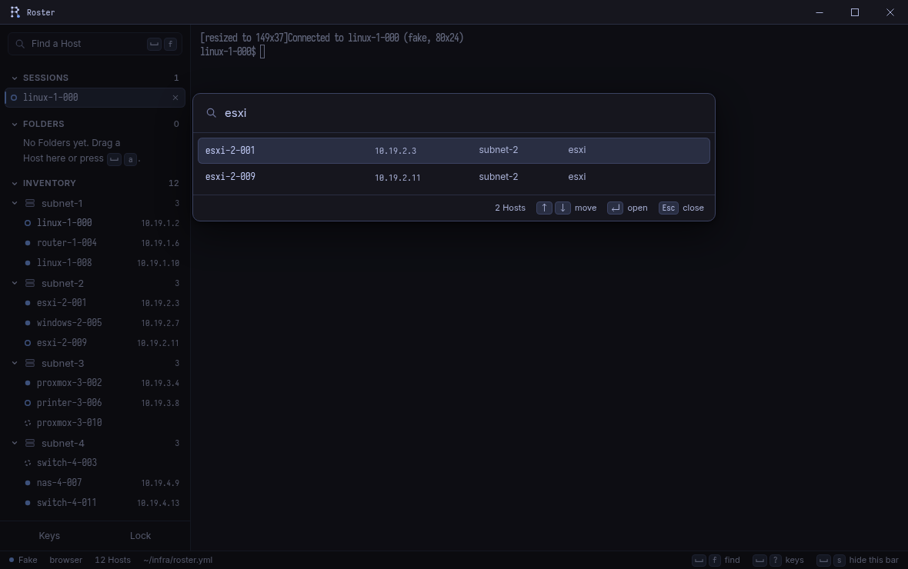 |
